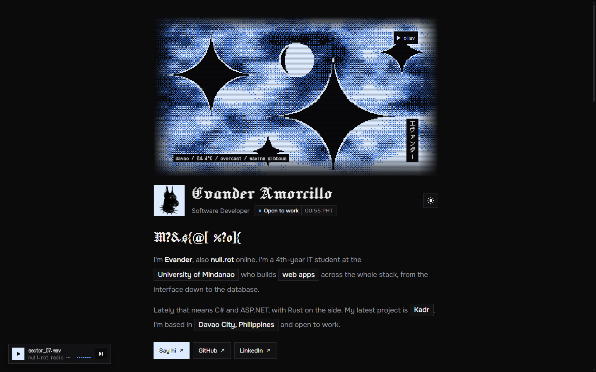
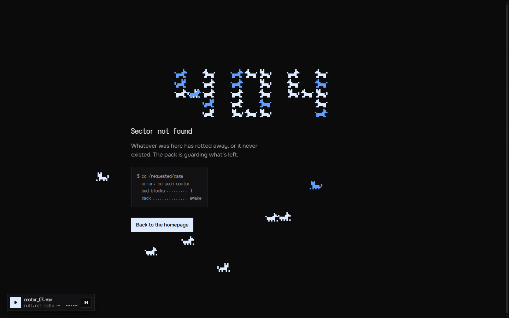

# Personal Resume

The portfolio of Evander Harold S. Amorcillo, a software developer in Davao City. A one-page resume in a 1-bit cybergrunge style.

**Live:** [amorcillo.vercel.app](https://amorcillo.vercel.app)



## What's on the page

- **A live sky.** The banner is a dithered sky drawn in the browser. It follows the real weather, time of day and moon phase over Davao.
- **A shared pixel wall.** A 32 × 8 wall of 1-bit pixels in the footer that every visitor draws on together. Changes are saved in Redis and show up for everyone.
- **A terminal.** A small fake shell on desktop. Open it with the backtick key and press Tab to complete commands.
- **Dog on the roof.** A 1-bit endless runner in a window of its own.
- **null.rot radio.** A tiny music player. The music is composed live with the Web Audio API, so there are no audio files.
- **A 404 with a pack.** Missing pages get a pack of 1-bit dogs and cats that spell out 404 and scatter from your cursor.
- **Six secrets.** The footer counts how many you've found.
- **Light and dark themes.** The new palette tears across the page when you switch. Everything respects reduced motion.



## Built with

Next.js, React, TypeScript and Tailwind CSS, hosted on Vercel. The pixel wall uses Upstash Redis. Tests run on Vitest.

## Running it

```bash
npm install
npm run dev
```

Then open http://localhost:3000. All of the resume text lives in `src/content/resume.ts`.

| Command | What it does |
| --- | --- |
| `npm run dev` | Starts the dev server |
| `npm test` | Runs the tests |
| `npm run lint` | Checks the code with ESLint |
| `npm run build` | Builds for production |

## Settings

The site runs without any settings. The pixel wall then shows "wall offline" and everything else works as normal. To turn the wall on, add an Upstash Redis database (Vercel's Upstash integration sets these for you):

| Variable | What it's for |
| --- | --- |
| `KV_REST_API_URL` or `UPSTASH_REDIS_REST_URL` | The Redis database's address |
| `KV_REST_API_TOKEN` or `UPSTASH_REDIS_REST_TOKEN` | The Redis database's access token |
| `WALL_ADMIN_TOKEN` | Optional. A long random password that lets the owner clear the wall |

Put them in `.env.local` for local work, or in the project's settings on Vercel.

## License

[MIT](LICENSE)
